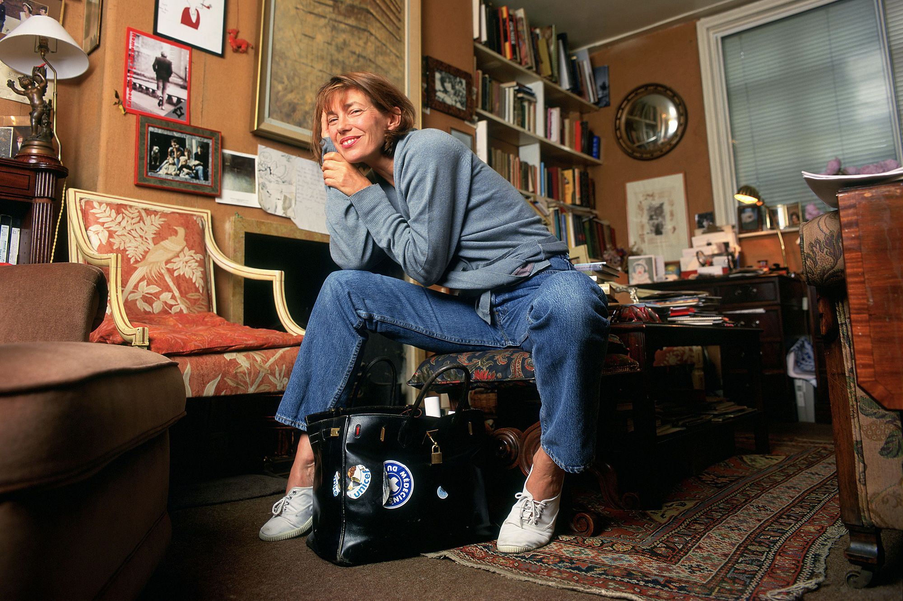

# Birkin Authentication
 
**Can a model trained only on authentic bags learn to spot counterfeits?**
 
A computer vision project that authenticates Hermès Birkin bags from close-up photos of the details expert authenticators inspect: heat stamps, blind stamps, stitching, and hardware.
 
<p align="center">
  
  <br />
  <em>Jane Birkin with her Birkin. Photo: Shutterstock.</em>
</p>
 
---
 
## Why This Project
 
The Birkin is one of the most valuable luxury goods in the world, and also one of the most counterfeited. On the resale market, it's often treated as an alternative asset, and some claim it has even outpaced both the S&P 500 and gold over the past few decades. With that much value on the line, authentication becomes a form of risk management, since a fake is a total loss. 

And when I finally get to buy one myself someday, I'll know it's real.

## History & Origin
 
The Birkin is Hermès' flagship handbag. Its story begins with actress and singer Jane Birkin, who was known for carrying a wicker basket instead of a handbag. On a flight from Paris to London, she ended up seated next to Hermès chief executive Jean-Louis Dumas. After her belongings spilled, she told him she couldn't find a leather bag big enough for everything she carried and sketched her ideal design on an airsickness bag. Hermès released the result in 1984 and named it in her honor.
 
The Birkin became a status symbol in the 1990s and has since been carried by everyone from Victoria Beckham and Kate Moss to the Olsen sisters. Jane Birkin herself was also an avid user of her original bag and covered it in stickers for causes like Médecins du Monde and UNICEF. The original was eventually sold at a charity auction in 1994, and in July 2025 it resold at Sotheby's Paris for €8.6 million (about US$10.1 million) with fees, making it the most expensive handbag ever sold at auction.
 
## Approach
 
### 1. Authenticate Details, Not Whole Bags
 
Full-bag photos invite the model to learn shortcuts (lighting, backgrounds, photo quality) instead of anything about the bag. So every image is cropped to one detail region:
 
| Region | What Authenticators Look For |
|---|---|
| Heat stamp | Font, letter spacing, accent on the "È", depth and crispness of the impression |
| Blind stamp | Date and craftsman code format, consistent with the bag's era |
| Stitching | Saddle-stitch angle, even tension, clean back-stitches and edge glazing |
| Hardware | Engraving quality, finish, lock and key details |
 
Each region gets its own score, and the app combines them into a per-detail report.
 
### 2. Anomaly Detection Instead of Plain Classification
 
Confirmed fakes are scarce and hard to label with confidence. Instead of relying on them for training, the main model learns what *authentic* looks like and flags anything that deviates. Confirmed fakes are used only for testing.
 
### 3. Pretrained Features
 
Detail crops are embedded with a pretrained vision model (DINOv2), and lightweight anomaly detectors are fit on top. A supervised real-vs-fake classifier is trained as a baseline for comparison.
 
## Data
 
Images are collected from resale platforms that guarantee authenticity, plus confirmed-fake examples from authentication communities. Every image is logged with:
 
- Source
- Detail region
- Label (authentic / fake)
- Label confidence (high / medium / low)
- Era (for blind stamp format)
**Images are not included in this repo.** They belong to their original sources, so only the metadata and collection guidelines are shared. See [`data/README.md`](data/README.md).
 
## Evaluation
 
The goal is an honest test, not an inflated number:
 
- **Source-held-out testing:** The model is evaluated on images from sources it never saw during training.
- **Real fakes only:** Test-set fakes are real counterfeits, never synthetic ones.
- **Metrics:** AUROC, plus how many fakes are caught at a fixed false-alarm rate on authentic bags.
- **Sanity checks:** Patch-level heatmaps confirm the model focuses on stamp lettering and stitching, not backgrounds.
## Results
 
*Coming soon.*
 
| Region | AUROC | Fakes Caught @ 5% False Alarms |
|---|---|---|
| Heat stamp | – | – |
| Blind stamp | – | – |
| Stitching | – | – |
| Hardware | – | – |
 
### Bonus Experiment
 
Does training on other Hermès bags help? The heat stamp font and stitching style are shared across many Hermès models. This compares a Birkin-only model against one that also trains on heat stamps from other leather Hermès bags, with both tested on Birkins only.
 
## Limitations
 
- **Superfakes:** High-end counterfeits can fool experienced authenticators, and they will likely fool this model too.
- **Label uncertainty:** Some fake labels come from community verdicts rather than professional authentication.
- **Photo dependence:** Results depend on clear and well lit close-ups.
## Repo Structure
 
```
birkin-authentication/
├── data/
│   ├── README.md          # collection and cropping guidelines
│   └── metadata.csv       # image sources and labels (no images)
├── notebooks/
│   ├── 01_explore.ipynb
│   ├── 02_baseline.ipynb
│   └── 03_anomaly_detection.ipynb
├── src/
│   ├── embed.py           # DINOv2 feature extraction
│   ├── train.py           # anomaly detectors + baseline classifier
│   ├── evaluate.py        # source-held-out evaluation
│   └── heatmaps.py        # patch-level anomaly maps
├── app/
│   └── app.py             # Gradio demo
├── requirements.txt
└── README.md
```
 
## Roadmap
 
- [ ] Build labeling guide and metadata spreadsheet
- [ ] Collect and crop authentic detail images
- [ ] Collect confirmed fakes for the test set
- [ ] DINOv2 embeddings + supervised baseline
- [ ] Anomaly detection models
- [ ] Source-held-out evaluation and heatmaps
- [ ] Hermès-widened training experiment
- [ ] Gradio demo on Hugging Face Spaces
- [ ] Future work: extending the method to luxury watches (Audemars Piguet Royal Oak)
## Disclaimer
 
This is a research and portfolio project, **not an authentication service.**
