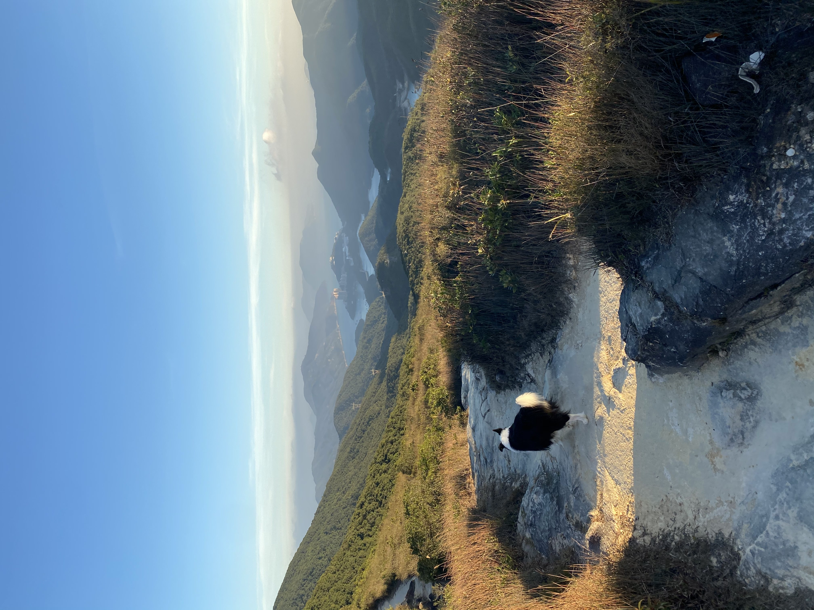

# Hiking Risk Model

A risk model for Hong Kong trails that estimates the probability of finishing a hike before sunset from any point on the route, and finds the quickest exit to a road, bus stop, or MTR station.
 
---

## Why This Project
 
<p align="center">
  
  <br />
  <em>On the Twin Peaks trail, Hong Kong Island.</em>
</p>

Growing up in Hong Kong, I spent a lot of weekends hiking. One of the most memorable was the Twin Peaks, which my friends and I hiked in sophomore year (the photo above is from that day). It's a 386m summit on Hong Kong Island, known for its 1,000+ steep concrete steps and a climb took us much longer than we'd planned. By the time we reached the end, it was completely dark. We made it out fine, but the experience stuck with me because we had no idea how much daylight we had left, or which way out was fastest.

## Approach
 
### 1. Trails as a Graph
 
Trails, roads, bus stops, and MTR stations come from OpenStreetMap. Trail junctions become nodes, trail segments become edges, and every road or transit stop is a possible exit.
 
### 2. Realistic Hiking Times
 
Hong Kong trails are steep, and a flat-ground pace badly underestimates them. Each segment's walking speed starts from Tobler's hiking function, which slows you down on steep climbs and descents:
 
```
speed (km/h) = 6 × exp(−3.5 × |slope + 0.05|)
```
 
Slopes come from the Lands Department's elevation model. The function's parameters are then calibrated against real Hong Kong hiking times.
 
### 3. Monte Carlo Finish-Before-Dark Probabilities
 
Pace varies by hiker, fatigue, and conditions, so it's modeled as a distribution rather than a single number. Thousands of simulated hikes from a given point produce a probability of reaching an exit before sunset (from the Hong Kong Observatory).
 
### 4. Fastest Way Out and Turnaround Times
 
A shortest-path search (Dijkstra / A*) on travel time finds the quickest exit from any point, which isn't always the trail's official end. Working backward from sunset gives the latest time you can be at each point and still get out in daylight.
 
## Data
 
| Source | Used For |
|---|---|
| OpenStreetMap | Trails, roads, bus stops, MTR stations |
| Lands Department elevation model | Slopes for each trail segment |
| Hong Kong Observatory | Sunset times by date |
| AFCD / official trail guides | Published section distances and walking times, for validation |
| Trail race results (e.g. MacLehose Trail events) | Checkpoint split times, to fit the pace distribution |
 
Map data © OpenStreetMap contributors, available under the Open Database License. Race results are used only where the event's terms allow, and raw data that can't be redistributed is not included in this repo. See [`data/README.md`](data/README.md).
 
## Evaluation
 
The goal is to check the model against reality, not just produce a map:
 
- **Time accuracy:** predicted vs. published walking times for each trail section, with error broken down by how steep the section is.
- **Calibration:** of the hikes the model gives an 80% chance of finishing before dark, do about 80% actually finish? Checked across probability ranges.
- **Baseline comparison:** calibrated model vs. uncalibrated Tobler vs. a simple flat-pace estimate.
## Results
 
*Coming soon.*
 
| Model | Section Time Error | Calibration Error |
|---|---|---|
| Flat pace (baseline) | – | – |
| Tobler (uncalibrated) | – | – |
| Tobler (calibrated to HK data) | – | – |
 
### Bonus Experiment
 
Does Tobler's function underestimate Hong Kong's stairs? Many local trails climb on concrete steps rather than dirt slopes. This compares error on stair-heavy sections vs. dirt-trail sections to see whether steps need their own speed adjustment.
 
## Limitations
 
- **Race data is fast:** trail race participants are fitter than the average hiker, so the fitted pace distribution likely runs optimistic.
- **Conditions aren't modeled:** heat, rain, typhoon signals, and slower movement after dark all matter and aren't included.
- **Map gaps:** OpenStreetMap coverage of small paths and recent trail closures can be incomplete.
- **One region:** results apply to Hong Kong's terrain and may not carry over elsewhere.
## Repo Structure
 
```
hk-hiking-risk-model/
├── data/
│   └── README.md          # sources, licenses, and how to download
├── notebooks/
│   ├── 01_explore.ipynb
│   ├── 02_calibration.ipynb
│   └── 03_monte_carlo.ipynb
├── src/
│   ├── graph.py           # build trail graph from OpenStreetMap + elevation
│   ├── pace.py            # Tobler function and calibration
│   ├── simulate.py        # Monte Carlo finish-before-dark probabilities
│   ├── routing.py         # fastest exit and turnaround times
│   └── evaluate.py        # time accuracy and calibration checks
├── app/
│   └── map.py             # interactive map of exit times and probabilities
├── requirements.txt
└── README.md
```
 
## Roadmap
 
- [ ] Build the trail graph for one network (MacLehose Trail)
- [ ] Add elevation and Tobler-based travel times
- [ ] Fastest-exit routing to roads and transit
- [ ] Validate against published section times
- [ ] Fit pace distribution from race splits
- [ ] Monte Carlo probabilities and calibration check
- [ ] Interactive map
- [ ] Stairs vs. dirt-trail experiment
- [ ] Future work: more trail networks (Lantau, Wilson Trail, Hong Kong Trail)
